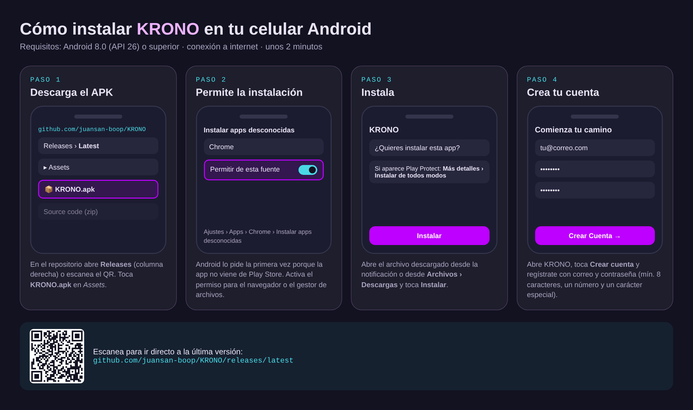
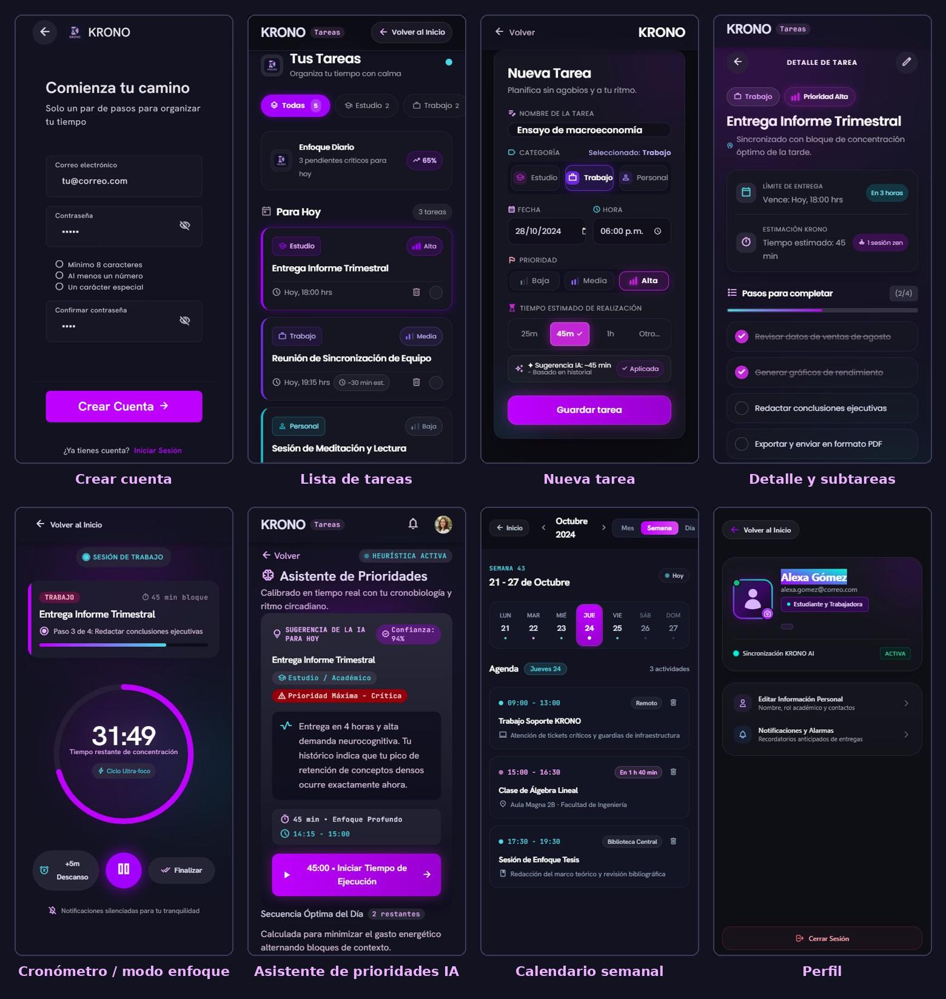

# KRONO

**Gestión del tiempo para estudiantes universitarios que también trabajan.**

KRONO es una aplicación móvil Android que, en vez de pedirle al usuario que adivine cuánto le va a tomar cada tarea (como Google Calendar, TickTick o Notion), mide la **duración real** con un cronómetro, aprende de ese historial y, con IA, sugiere estimaciones personalizadas y el orden en que conviene hacer las tareas.


---

## 👥 Integrantes

| Integrante | Responsabilidad principal |
|---|---|
| **Juan Fernando Sánchez Otero** | `app`, módulos `core-*`, autenticación, dashboard, calendario, onboarding, modo enfoque y plantillas, reglas de Firestore |
| **Kevin Vuskovit García González** | Cronómetro de duración real, estimación basada en historial, asistente de prioridades con IA |
| **Janer García Avendaño García** | Persistencia de tareas en Firestore y pantallas de tareas (lista, crear, editar, detalle, eliminar/posponer) |
| **Juan Esteban Sora Ariza** | Perfil de usuario, ajustes, notificaciones y zona de seguridad |

## 🔗 Repositorio y rama de entrega

- **Repositorio público:** https://github.com/juansan-boop/KRONO
- **Rama con la última versión funcional:** [`develop`](https://github.com/juansan-boop/KRONO/tree/develop)

> La rama `main` contiene solo el cierre de la fase 0 (infraestructura). Todo el desarrollo posterior, incluida la versión presentada, está integrado en **`develop`**, que es la rama por defecto del repositorio.

```bash
git clone -b develop https://github.com/juansan-boop/KRONO.git
```

---

## 📲 Instalación (recomendada): descargar el APK

No hace falta compilar nada. La versión lista para instalar está publicada en **[Releases → última versión](https://github.com/juansan-boop/KRONO/releases/latest)**.

**Requisitos:** celular Android 8.0 (API 26) o superior, con conexión a internet.



1. **Descarga el APK.** En el repositorio entra a **Releases** (columna derecha de la página) o escanea el QR de la imagen, y toca **`KRONO.apk`** en la sección *Assets*. También puedes usar el enlace directo: [KRONO.apk](https://github.com/juansan-boop/KRONO/releases/latest/download/KRONO.apk).
2. **Permite la instalación.** Como la app no viene de Play Store, Android pide autorizar la fuente la primera vez: *Ajustes → Apps → Chrome (o tu gestor de archivos) → Instalar apps desconocidas → Permitir de esta fuente*.
3. **Instala.** Abre el archivo descargado (desde la notificación o desde *Archivos → Descargas*) y toca **Instalar**. Si aparece Google Play Protect, elige *Más detalles → Instalar de todos modos*.
4. **Crea tu cuenta.** Abre KRONO, toca **Crear cuenta** y regístrate con correo y contraseña (mínimo 8 caracteres, un número y un carácter especial). Desde ahí ya puedes crear tareas y usar el cronómetro.

<details>
<summary><b>Alternativa: instalar desde el computador con ADB</b></summary>

Con el celular conectado por USB y la *Depuración USB* activada (*Ajustes → Opciones de desarrollador*):

```bash
adb install KRONO.apk
```
</details>

---

## ✨ Funcionalidades

- **Tareas** con categoría (Estudio, Trabajo, Personal), prioridad, fecha límite y subtareas; crear, editar, eliminar y posponer.
- **Cronómetro de duración real**: registra cuánto tomó cada tarea de verdad.
- **Modo enfoque** por bloques de concentración, con plantillas reutilizables.
- **Estimación basada en historial**: KRONO sugiere cuánto te tomará una tarea a partir de lo que has medido.
- **Asistente de prioridades con IA** (Gemini a través de Firebase AI Logic) que explica qué hacer primero y por qué.
- **Agente de planificación**: le escribes lo que tienes pendiente y propone las tareas y su orden.
- **Dashboard diario** y **calendario** en vistas de día, semana y mes.
- **Perfil, ajustes, notificaciones y zona de seguridad.**
- **Cuenta y sincronización** con Firebase Authentication y Cloud Firestore (funciona sin conexión gracias a la caché offline).

## 🖼️ Pantallas



*Diseño de referencia de las pantallas principales (Google Stitch, sistema de diseño Lumina Glass). El export completo, una carpeta por pantalla, está en [`design/`](design/).*

---

## 🛠️ Compilar desde el código fuente

Esta sección es para quien quiera revisar o modificar el código. Para solo usar la app, basta con el APK de arriba.

### Requisitos

- [Android Studio](https://developer.android.com/studio) (última versión estable)
- **JDK 17** (obligatorio: con el JDK 25 que trae Android Studio el build falla por un JVM target inconsistente en `core-common:compileKotlin`)
- Android SDK 35 (compileSdk), mínimo API 26

### Pasos

1. **Clona la rama `develop`** y ábrela con Android Studio (*File → Open* → carpeta `KRONO`).
   ```bash
   git clone -b develop https://github.com/juansan-boop/KRONO.git
   ```
2. **Configura JDK 17:** *Settings → Build, Execution, Deployment → Build Tools → Gradle → Gradle JDK* = 17. Desde la terminal, apunta `JAVA_HOME` a un JDK 17.
3. **Agrega la configuración de Firebase.** El archivo `app/google-services.json` **no se versiona** porque contiene la configuración real del proyecto. Pídeselo al equipo o crea tu propio proyecto en [Firebase Console](https://console.firebase.google.com/):
   - Registra una app Android con el paquete **`com.krono.app`** y descarga su `google-services.json` a la carpeta `app/`.
   - Habilita **Authentication → Correo/contraseña**.
   - Crea una base de datos **Cloud Firestore** y publica las reglas de [`firestore.rules`](firestore.rules) (ver [`docs/firestore-rules.md`](docs/firestore-rules.md)).
   - Habilita **Firebase AI Logic** con la *Gemini Developer API* para el asistente y el agente de IA (la app no guarda ninguna clave de API).
4. **Compila e instala** en un emulador o celular conectado con el botón ▶ *Run* de Android Studio, o desde la terminal:
   ```bash
   ./gradlew assembleDebug
   # APK generado en: app/build/outputs/apk/debug/app-debug.apk
   ./gradlew installDebug   # instala en el dispositivo conectado
   ```

> Sin un `google-services.json` real la app compila (el CI usa uno de relleno), pero no puede iniciar sesión ni guardar datos.

### Verificación

Los mismos comandos que ejecuta el CI (GitHub Actions) en cada PR:

```bash
./gradlew lint testDebugUnitTest assembleDebug
```

---

## 🧱 Arquitectura y tecnologías

- **Kotlin** + **Jetpack Compose** (sin layouts XML), **MVVM + Clean Architecture**, inyección de dependencias con **Hilt**.
- **Firebase Authentication** y **Cloud Firestore** como fuente única de datos; **Firebase AI Logic (Gemini)** para la IA.
- Sistema de diseño propio **Lumina Glass System**: glassmorphism oscuro, magenta `#BD00FF` y cyan `#49D9E5` sobre `#121221`.

```
app/                    → punto de entrada, navegación entre features
core/
  core-common/          → utilidades compartidas, sin dependencias de Android
  core-domain/          → modelos y casos de uso, Kotlin puro
  core-data/            → Firebase (Auth, Firestore, AI Logic), repositorios
  core-ui/              → tema Lumina Glass System (Color, Type, Shape, Theme, Glass)
feature-auth/           → login, registro, recuperar contraseña
feature-onboarding/     → flujo inicial
feature-dashboard/      → inicio, notificaciones
feature-tasks/          → CRUD de tareas, cronómetro, IA de priorización, modo enfoque
feature-calendar/       → vistas día/semana/mes
feature-profile/        → perfil, ajustes, zona de seguridad
KRONO-IA/               → scripts Python del modelo de estimación (datos, entrenamiento y resultados)
design/                 → export de Google Stitch (referencia visual por pantalla)
docs/                   → especificación (SPEC.md) e imágenes del README
```

Reglas principales: ningún `feature-*` importa a otro directamente, los ViewModel no importan `androidx.compose.*` y no hay colores ni espaciados hardcodeados fuera de `core-ui`.

## 📄 Documentación

- [`docs/SPEC.md`](docs/SPEC.md) — especificación del producto: funcionalidades, criterios de aceptación y decisiones.
- [Arquitectura de KRONO](https://claude.ai/artifact/L99qFGLCZM7ULg2smLXi5M) — recap de la estructura de módulos y sus reglas.
- [`CONTRIBUTING.md`](CONTRIBUTING.md) — estrategia de ramas y Conventional Commits.
- [`CLAUDE.md`](CLAUDE.md) — contexto del proyecto usado al trabajar con Claude Code.
